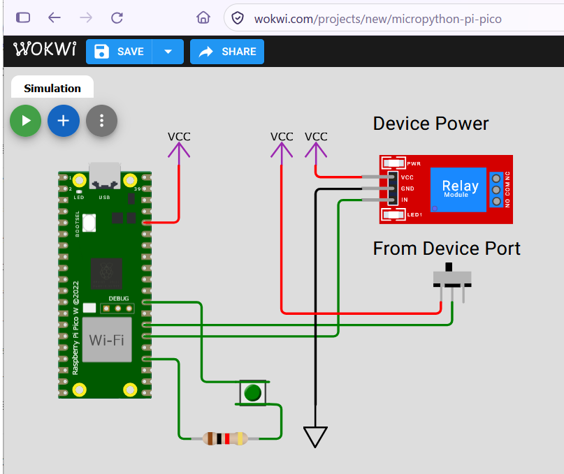

# pico Soft Power Switch

Raspberry Piに使えるソフト・パワースイッチです  
物理的には電源ONボタンを持ち、電源OFFボタンはシャットダウン手続きを考慮して電源制御される側で準備します  



## 必要なもの
- ターゲットデバイス(例えば Raspberry pi zero 2 W、このシステムを制御する用にOutput portが必要)
- タクトSwitch(Power On Button) x 1
- Relayモジュール (3.3V駆動)(私の場合は、AC100VをOn/Offできるものを使用) x 1
- 抵抗 1kΩ x 1
- ヘッダーピン用接続ケーブル x 8
- 電源用USB A - micoro Bケーブル x 1
- ACアダプタ(5V, USB Aメス コネクタ) x 1

## 動作
- pico のGPIO21に接続した Tackical Switch を1秒以上押すと、GPIO20に接続したRelayをONにします  
- RelayでTarget Deviceの電源をOnにします  
- その後、targetが起動したら、制御用のポートを Low Level から High Level に変更し、PICO GPIO20 を High Level にします  
- この状態で起動シーケンスが終了です  
- Raspberry Pi Zero 2 W に接続した物理的な Tactical Sw が押されたり、Networkの先のスマホからの指示で Shutdown シーケンスを始めます  
- Raspberry Pi Zero 2 W のShutdown シーケンス の途中で制御用ポートを High Level から Low Level に変更するので
- Pico Pi 側で設定した秒数(DEC_TIME) 待ってから、RELAYをOffします  
- これにより Raspberry Pi Zero 2 W がshutdown途中で強制電源OFFされないようにしています

### Timing Chart
```
                            ________ 
      SW_PIN(GPIO22) ______|        |______________________________________________________
                            _   _   ______________________________   _   _   _   _   _
     LED_PIN(GPIO25) ______| |_| |_|                              |_| |_| |_| |_| |_| |____
                      _____________________________________________________________________
 VIRTUAL_VDD(GPIO18) |
                                         _________________________
    SENS_PIN(GPI21)  ___________________|                         |________________________
                                    __________________________________________________
   RELAY_PIN(GPIO20) ______________|                                                  |____
                                                      ^            <--- DEC_TIME ---->
                                                      Shutdown
```


## 謝辞
- [WOKWI](https://wokwi.com)  
 回路図が書けること  
 回路シミュレーションが出来ること  
 タクトスイッチがシミュレーション時にマウスのクリックでOn/Off切り替わること 
- これらが使いやすく、readmeを書くうえで便利に使えた
